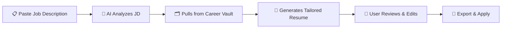
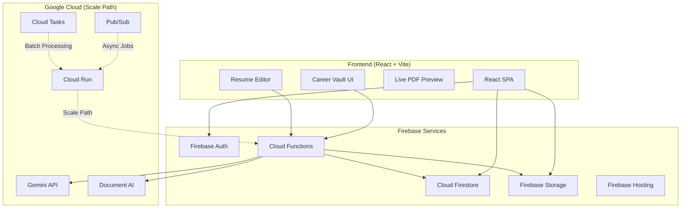
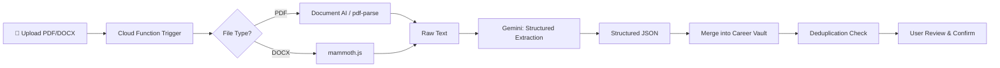
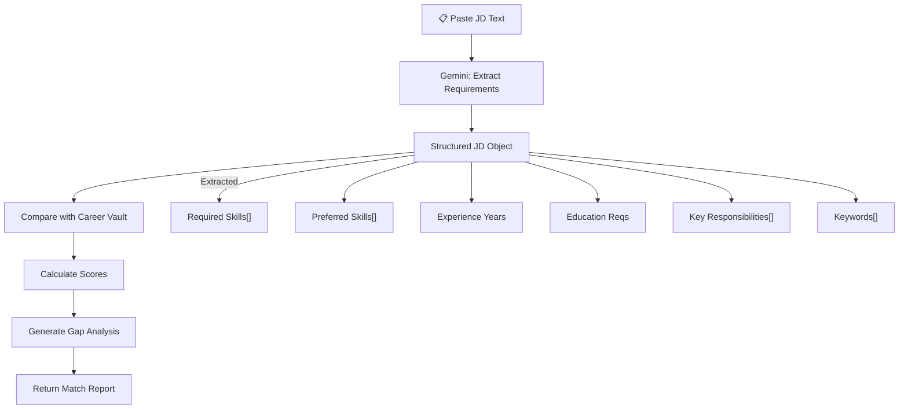
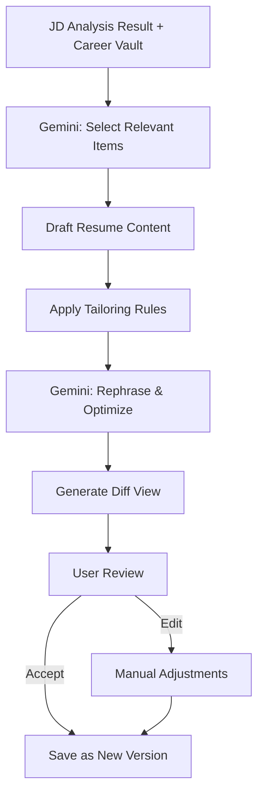
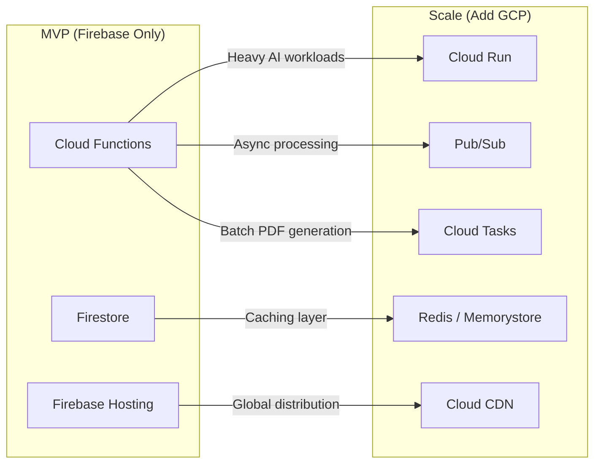

# 🚀 ResumeForge — AI-Powered Resume Builder

## Product Blueprint & MVP Plan

---

## 1. Product Vision

**ResumeForge** is an AI-powered resume builder that acts as a user's **career companion**. Instead of manually tailoring resumes for every job, users dump their entire career history into a **Career Vault**, and the AI crafts the perfect, targeted resume for any job description — in any format they choose.

> [!IMPORTANT]
> **Core Value Proposition**: "Dump your career once. Get the perfect resume every time."

---

## 2. Feature Breakdown

### 🏗️ CORE FEATURES (MVP)

#### Feature 1: Career Vault (The "CV Dump")
This is the **heart** of the product. A centralized repository where users store ALL their career data.

| Data Type | Description | Input Method |
|-----------|-------------|--------------|
| **Work Experience** | All jobs, roles, responsibilities, achievements | Manual form / PDF upload / paste |
| **Projects** | Personal, professional, open-source projects with descriptions, tech stacks, links | Manual form / GitHub import |
| **Education** | Degrees, certifications, coursework, GPA | Manual form |
| **Skills** | Technical skills, soft skills, tools, frameworks with proficiency levels | Manual + AI extraction |
| **Awards & Honors** | Hackathon wins, employee awards, publications | Manual form |
| **Certifications** | Professional certifications with dates and IDs | Manual form |
| **Publications** | Research papers, blog posts, articles | Manual + DOI/URL import |
| **Volunteering** | Community service, mentoring, open-source contributions | Manual form |
| **Recommendations** | Quotes, testimonials from colleagues/managers | Manual paste |
| **Custom Sections** | Anything else — patents, speaking engagements, languages, hobbies | Flexible form builder |

**How the Vault works:**
```
┌─────────────────────────────────────────────────────┐
│                   CAREER VAULT                       │
│                                                      │
│  📄 Upload existing CVs (PDF/DOCX) ──→ AI parses    │
│     and extracts structured data automatically       │
│                                                      │
│  ✍️  Manual entry via guided forms                   │
│                                                      │
│  🔗 Import from LinkedIn / GitHub (future)           │
│                                                      │
│  📊 AI enriches: suggests missing skills,            │
│     quantifies achievements, improves bullet points  │
│                                                      │
│  🗂️  Everything is tagged, searchable, and versioned │
└─────────────────────────────────────────────────────┘
```

**Key Vault Capabilities:**
- **Multi-CV Upload**: Users can upload 5, 10, 20 old resumes — the AI deduplicates and merges all data into one unified profile
- **Smart Parsing**: Uses Gemini API to extract structured data from unstructured PDFs
- **Data Enrichment**: AI suggests quantifiable metrics ("managed a team" → "managed a team of 12 engineers, delivering 3 products")
- **Version History**: Every change tracked, nothing ever lost
- **Tags & Categories**: Auto-categorized for easy filtering

---

#### Feature 2: Multi-Format Resume Templates

Users pick from multiple professional templates, each optimized for different industries and roles.

| Template Category | Styles | Best For |
|-------------------|--------|----------|
| **Classic** | Traditional, Corporate, Executive | Enterprise, Banking, Consulting |
| **Modern** | Clean, Minimal, Two-Column | Tech, Startups, Design |
| **Creative** | Infographic, Timeline, Portfolio-style | Design, Marketing, Media |
| **ATS-Optimized** | Simple, keyword-dense, parseable | Any job with automated screening |
| **Academic** | CV-style, multi-page, detailed | Research, PhD, Academia |
| **Federal** | USAJobs-style, detailed, long-form | Government positions |

**Template Features:**
- Real-time preview as you edit
- Color scheme customization (brand colors, dark/light)
- Font selection (professional fonts via Google Fonts)
- Section reordering via drag-and-drop
- Export to **PDF**, **DOCX**, **HTML**, **Plain Text**
- A4 and US Letter sizing
- One-click template switching (content preserved)

---

#### Feature 3: JD Match Score & Analysis

Paste a job description → get an instant, detailed match analysis.

```
┌──────────────────────────────────────────────────────────┐
│            JD MATCH ANALYSIS                              │
│                                                           │
│  Overall Match Score:  ████████████░░░░  78%              │
│                                                           │
│  📊 Breakdown:                                            │
│  ├── Skills Match:        ██████████░░░░░  85%            │
│  ├── Experience Match:    ████████░░░░░░░  70%            │
│  ├── Education Match:     ████████████████  100%          │
│  ├── Keywords Coverage:   ██████████░░░░░  75%            │
│  └── Seniority Fit:       ██████░░░░░░░░░  60%            │
│                                                           │
│  ✅ MATCHED SKILLS:                                       │
│  React, TypeScript, Node.js, AWS, CI/CD, Agile            │
│                                                           │
│  ❌ MISSING / GAP SKILLS:                                 │
│  Kubernetes (mentioned 3x), Terraform (mentioned 2x)      │
│  → Suggestion: You have Docker experience. Kubernetes      │
│    is closely related — consider highlighting container    │
│    orchestration experience.                               │
│                                                           │
│  ⚠️  KEYWORD GAPS:                                        │
│  "cross-functional collaboration" — you have this          │
│  experience but used different phrasing. Recommend          │
│  mirroring JD language.                                    │
│                                                           │
│  💡 RECOMMENDATIONS:                                       │
│  1. Add Kubernetes to skills (if any exposure)             │
│  2. Emphasize leadership metrics in Experience #2          │
│  3. Reorder skills to match JD priority                    │
│  4. Add "cross-functional" keyword to bullet points        │
└──────────────────────────────────────────────────────────┘
```

**Scoring Algorithm (powered by Gemini):**
1. **Hard Skills Extraction** — Extract required/preferred skills from JD
2. **Semantic Matching** — Not just keyword matching; understands "React.js" = "React" = "ReactJS"
3. **Experience Level Parsing** — Maps "5+ years" to actual user experience duration
4. **Keyword Density Analysis** — Identifies ATS-critical keywords
5. **Soft Skills Detection** — Maps leadership, communication requirements
6. **Culture Fit Signals** — Startup vs corporate language patterns

---

#### Feature 4: AI Resume Tailoring (JD-Based Modification)

The killer feature. One-click resume customization for any job.

**How it works:**



**Tailoring Rules (Critical — maintains authenticity):**

> [!CAUTION]
> The AI NEVER fabricates experience, skills, or achievements. It only:
> - **Reorders** sections to prioritize relevant experience
> - **Rephrases** existing bullets to mirror JD language
> - **Selects** the most relevant projects/experiences from the Vault
> - **Emphasizes** transferable skills that map to JD requirements
> - **Adjusts** the professional summary/objective
> - **Omits** irrelevant experience (with user approval)

**User Controls:**
- **Lock sections**: "Never change my Skills section"
- **Core domain protection**: Mark core skills as "always include"
- **Modification intensity slider**: Conservative ↔ Aggressive
- **Side-by-side diff view**: See exactly what changed and why
- **Accept/reject per change**: Granular control over every modification
- **One-click revert**: Go back to any previous version

---

### 🌟 ADDITIONAL FEATURES (Suggested)

#### Feature 5: Cover Letter Generator
- Auto-generates cover letters based on JD + Career Vault
- Multiple tones: Professional, Enthusiastic, Executive, Conversational
- Template library for different formats
- Pairs with the tailored resume for a complete application package

#### Feature 6: LinkedIn Profile Optimizer
- Compares LinkedIn profile text with Career Vault data
- Suggests headline, summary, and experience improvements
- Generates LinkedIn-optimized text (different writing style than resumes)
- Keywords optimization for LinkedIn search algorithm

#### Feature 7: Application Tracker Dashboard
- Track every job application in one place
- Status pipeline: Saved → Applied → Interview → Offer → Accepted/Rejected
- Links resume version used for each application
- Reminder notifications for follow-ups
- Analytics: applications per week, response rates, best-performing resume versions

#### Feature 8: Interview Prep Module
- Based on JD + resume, generates likely interview questions
- STAR method answer frameworks pre-filled with Vault data
- Company research auto-fetcher (basic info, recent news, Glassdoor data)
- Mock interview practice mode (text-based MVP, voice later)

#### Feature 9: Resume Analytics & Insights
- Which resume versions get the most interviews (user self-reported)
- A/B testing suggestions for bullet points
- Industry benchmarks (average skills count, experience length for similar roles)
- ATS simulation: Run your resume through a simulated ATS parser

#### Feature 10: Collaboration & Review
- Share resume with mentors/friends for review
- Inline commenting system
- AI grammar and consistency checker
- Professional tone analyzer

#### Feature 11: Smart Suggestions Engine
- "You haven't updated your resume in 3 months — here are new skills trending in your field"
- "Based on your career trajectory, consider highlighting X for senior roles"
- Skill gap analysis: "To move from Mid to Senior, you typically need: ..."
- Salary range estimation based on skills and experience level

#### Feature 12: Multi-Language Support
- Resume translation for international applications
- Locale-specific formatting (date formats, photo inclusion norms, etc.)
- Cultural adaptation (US vs EU vs Asian resume conventions)

---

## 3. Technical Architecture

### High-Level Architecture



### Tech Stack Details

| Layer | Technology | Why |
|-------|-----------|-----|
| **Frontend** | React 18 + Vite + TypeScript | Fast builds, type safety, ecosystem |
| **UI Library** | Tailwind CSS + shadcn/ui | Rapid prototyping, beautiful defaults |
| **State Management** | Zustand | Lightweight, simple, scales well |
| **Resume Editor** | Custom React components + react-pdf | Full control over rendering |
| **PDF Generation** | `@react-pdf/renderer` (client) + Puppeteer on Cloud Functions (server) | Client-side preview + server-side high-quality export |
| **Rich Text** | Tiptap (ProseMirror-based) | Best-in-class editor for bullet points |
| **Drag & Drop** | dnd-kit | Section reordering |
| **Auth** | Firebase Auth (Google, Email, GitHub) | Zero-config, scales free |
| **Database** | Cloud Firestore | Real-time, offline support, scales |
| **File Storage** | Firebase Storage | CV uploads, generated PDFs |
| **Serverless** | Firebase Cloud Functions (Gen 2) | AI processing, PDF generation |
| **AI/LLM** | Gemini 2.0 Flash / Pro via API | JD analysis, resume tailoring, scoring |
| **PDF Parsing** | Google Document AI / pdf-parse | Extract text from uploaded CVs |
| **Hosting** | Firebase Hosting | CDN, SSL, custom domains |
| **Analytics** | Firebase Analytics + GA4 | User behavior tracking |
| **Monitoring** | Firebase Crashlytics + Cloud Logging | Error tracking |

### Database Schema (Firestore)

```
users/
  {userId}/
    profile: { name, email, photoURL, plan, createdAt }
    settings: { defaultTemplate, colorScheme, preferences }

    # Career Vault
    vault/
      experiences/
        {expId}: { company, role, startDate, endDate, bullets[], skills[], isCore }
      projects/
        {projId}: { name, description, techStack[], url, highlights[] }
      education/
        {eduId}: { institution, degree, field, gpa, startDate, endDate }
      skills/
        {skillId}: { name, category, proficiency, yearsOfExperience, isCore }
      certifications/
        {certId}: { name, issuer, date, expiryDate, credentialId }
      awards/
        {awardId}: { title, issuer, date, description }
      uploads/
        {uploadId}: { fileName, storageRef, parsedData, uploadedAt }

    # Generated Resumes
    resumes/
      {resumeId}/
        metadata: { title, template, createdAt, updatedAt, forJobId? }
        content: { sections[], selectedItems[] }
        versions/
          {versionId}: { content, createdAt, changeLog }

    # Job Applications
    jobs/
      {jobId}: { title, company, jdText, matchScore, status, appliedAt, resumeId }

    # Cover Letters
    coverLetters/
      {clId}: { jobId, content, tone, template, createdAt }

# Shared Templates (Admin-managed)
templates/
  {templateId}: { name, category, thumbnail, layoutConfig, isPublic }
```

### Storage Structure (Firebase Storage)

```
users/{userId}/
  uploads/          # Raw CV uploads (PDF, DOCX)
  generated/        # Generated resume PDFs
  exports/          # Exported files
  profile/          # Profile photos
```

---

## 4. AI Pipeline Architecture

### Resume Parsing Pipeline



### JD Analysis & Scoring Pipeline



### Resume Tailoring Pipeline



### Gemini Prompt Strategy

```
System Prompt (for tailoring):
"You are a professional resume writer and career coach.
Given a user's complete career data (Career Vault) and a
target job description, create the most effective resume.

STRICT RULES:
1. NEVER invent or fabricate any experience, skill, or achievement
2. Only use data that exists in the Career Vault
3. Rephrase bullets to mirror JD language where naturally fitting
4. Prioritize items marked as 'isCore: true' — always include them
5. Select the most relevant 3-5 experiences
6. Quantify achievements where data exists
7. Output valid JSON matching the resume schema"
```

---

## 5. MVP Scope & Phased Rollout

### Phase 1: MVP (4-6 weeks)

> [!TIP]
> Ship the MVP with the smallest feature set that delivers the core value proposition.

| Feature | Priority | Effort |
|---------|----------|--------|
| User auth (Google + Email) | P0 | 2 days |
| Career Vault — manual data entry forms | P0 | 5 days |
| Career Vault — PDF upload + AI parsing | P0 | 4 days |
| 3 resume templates (Modern, Classic, ATS) | P0 | 5 days |
| Resume editor with live preview | P0 | 5 days |
| PDF export | P0 | 3 days |
| JD paste + match score | P0 | 4 days |
| AI resume tailoring (basic) | P0 | 5 days |
| Dashboard — list resumes & jobs | P0 | 3 days |
| **Total MVP** | | **~36 days** |

### Phase 2: Enhancement (Weeks 7-10)

| Feature | Priority |
|---------|----------|
| Cover letter generator | P1 |
| Application tracker | P1 |
| More templates (6 total) | P1 |
| DOCX export | P1 |
| Resume version history | P1 |
| Side-by-side diff view | P1 |

### Phase 3: Growth (Weeks 11-16)

| Feature | Priority |
|---------|----------|
| Interview prep module | P2 |
| LinkedIn optimizer | P2 |
| Collaboration/sharing | P2 |
| Smart suggestions engine | P2 |
| Analytics dashboard | P2 |
| Multi-language support | P2 |

---

## 6. Scalability Path

### From MVP to Scale



### Scaling Strategies

| Concern | MVP Solution | Scale Solution |
|---------|-------------|----------------|
| **AI Rate Limits** | Direct Gemini API calls | Cloud Tasks queue + rate limiting |
| **PDF Generation** | Client-side react-pdf | Puppeteer on Cloud Run (headless Chrome) |
| **File Processing** | Synchronous Cloud Functions | Pub/Sub → Cloud Run workers |
| **Database Reads** | Firestore direct | Firestore + Redis cache layer |
| **Search** | Firestore queries | Algolia / Elasticsearch |
| **CDN** | Firebase Hosting | Cloud CDN + global edge |
| **Auth** | Firebase Auth | Firebase Auth + Identity Platform |
| **Multi-tenant** | Single Firestore DB | Sharded collections / per-tenant projects |
| **Monitoring** | Console logs | Cloud Monitoring + Alerting + Dashboards |
| **CI/CD** | Manual deploy | Cloud Build → Firebase Deploy |

### Cost Estimation (MVP)

| Service | Free Tier | Expected MVP Cost |
|---------|-----------|-------------------|
| Firebase Auth | 10K MAU free | \$0 |
| Firestore | 1GB storage, 50K reads/day | \$0 - \$25/mo |
| Cloud Functions | 2M invocations/mo | \$0 - \$10/mo |
| Firebase Storage | 5GB free | \$0 - \$5/mo |
| Firebase Hosting | 10GB transfer/mo | \$0 |
| Gemini API | Free tier available | \$10 - \$50/mo (usage dependent) |
| Document AI | 1K pages/mo free | \$0 - \$10/mo |
| **Total** | | **\$0 - \$100/mo** |

---

## 7. Project Structure

```
resumeforge/
├── public/
│   ├── index.html
│   ├── favicon.ico
│   └── templates/          # Template thumbnails
├── src/
│   ├── main.tsx
│   ├── App.tsx
│   ├── routes/
│   │   ├── index.tsx        # Landing page
│   │   ├── dashboard.tsx    # Main dashboard
│   │   ├── vault.tsx        # Career Vault
│   │   ├── editor.tsx       # Resume editor
│   │   ├── templates.tsx    # Template gallery
│   │   ├── jobs.tsx         # Job tracker
│   │   └── settings.tsx     # User settings
│   ├── components/
│   │   ├── ui/              # shadcn components
│   │   ├── layout/          # Header, Sidebar, Footer
│   │   ├── vault/           # Vault-related components
│   │   │   ├── ExperienceForm.tsx
│   │   │   ├── SkillsManager.tsx
│   │   │   ├── FileUploader.tsx
│   │   │   ├── VaultOverview.tsx
│   │   │   └── ParsedDataReview.tsx
│   │   ├── editor/          # Resume editor components
│   │   │   ├── ResumeEditor.tsx
│   │   │   ├── SectionEditor.tsx
│   │   │   ├── LivePreview.tsx
│   │   │   ├── TemplateSelector.tsx
│   │   │   └── DiffView.tsx
│   │   ├── jobs/            # Job matching components
│   │   │   ├── JDInput.tsx
│   │   │   ├── MatchScoreCard.tsx
│   │   │   ├── GapAnalysis.tsx
│   │   │   └── TailorButton.tsx
│   │   └── shared/          # Shared components
│   │       ├── PDFExport.tsx
│   │       ├── LoadingStates.tsx
│   │       └── EmptyStates.tsx
│   ├── hooks/
│   │   ├── useAuth.ts
│   │   ├── useVault.ts
│   │   ├── useResume.ts
│   │   ├── useMatchScore.ts
│   │   └── useAITailor.ts
│   ├── stores/
│   │   ├── authStore.ts
│   │   ├── vaultStore.ts
│   │   └── editorStore.ts
│   ├── services/
│   │   ├── firebase.ts      # Firebase init
│   │   ├── auth.ts          # Auth service
│   │   ├── firestore.ts     # DB operations
│   │   ├── storage.ts       # File upload/download
│   │   ├── ai.ts            # AI/Gemini calls
│   │   └── pdf.ts           # PDF generation
│   ├── lib/
│   │   ├── prompts/         # Gemini prompt templates
│   │   │   ├── parseResume.ts
│   │   │   ├── analyzeJD.ts
│   │   │   ├── matchScore.ts
│   │   │   ├── tailorResume.ts
│   │   │   └── generateCoverLetter.ts
│   │   ├── scoring/         # Scoring algorithms
│   │   │   ├── skillsMatch.ts
│   │   │   ├── experienceMatch.ts
│   │   │   └── overallScore.ts
│   │   ├── parsers/         # Document parsers
│   │   │   ├── pdfParser.ts
│   │   │   └── docxParser.ts
│   │   └── utils/
│   │       ├── formatting.ts
│   │       ├── validation.ts
│   │       └── constants.ts
│   ├── types/
│   │   ├── vault.ts         # Career Vault types
│   │   ├── resume.ts        # Resume types
│   │   ├── job.ts           # Job/JD types
│   │   └── template.ts      # Template types
│   └── styles/
│       └── globals.css
├── functions/               # Firebase Cloud Functions
│   ├── src/
│   │   ├── index.ts
│   │   ├── parseDocument.ts   # PDF/DOCX parsing
│   │   ├── analyzeJD.ts       # JD analysis
│   │   ├── generateResume.ts  # AI resume generation
│   │   ├── generatePDF.ts     # Server-side PDF
│   │   └── matchScore.ts      # Scoring engine
│   ├── package.json
│   └── tsconfig.json
├── firestore.rules
├── storage.rules
├── firebase.json
├── package.json
├── tsconfig.json
├── vite.config.ts
├── tailwind.config.ts
└── README.md
```

---

## 8. Key Screens (UI Wireframe Descriptions)

### Screen 1: Dashboard
- Welcome banner with quick stats (resumes count, applications, avg match score)
- Recent resumes grid with thumbnails
- Quick actions: "Create Resume", "Upload CV", "Paste JD"
- Activity timeline

### Screen 2: Career Vault
- Tab-based navigation: Experience | Projects | Education | Skills | Awards | Uploads
- Each tab shows cards/list of entries with edit/delete
- "Upload CV" prominent button with drag-drop zone
- "AI Enrich" button that enhances existing bullet points
- Completeness meter: "Your vault is 72% complete — add certifications to improve"

### Screen 3: Resume Editor
- Left panel: Section list (drag to reorder) + Vault item selector
- Center: WYSIWYG-ish editor with Tiptap for bullet points
- Right panel: Live PDF preview (real-time render)
- Top bar: Template selector, color picker, font picker, export button
- Bottom bar: Save, version history, share

### Screen 4: JD Match & Tailor
- Left: Large textarea to paste JD + "Analyze" button
- Right: Match score dashboard (radial chart + breakdowns)
- Below: Gap analysis with actionable recommendations
- "Auto-Tailor Resume" button → opens editor with diff view
- Side-by-side: Original vs Tailored with highlighted changes

### Screen 5: Template Gallery
- Grid of template previews with hover effects
- Filter by category (Modern, Classic, Creative, ATS)
- "Preview with my data" button
- Premium templates marked (for monetization)

---

## 9. Monetization Strategy (Future)

| Tier | Price | Includes |
|------|-------|----------|
| **Free** | \$0 | 1 resume, 3 templates, 5 JD analyses/mo, basic Vault |
| **Pro** | \$9/mo | Unlimited resumes, all templates, unlimited JD analyses, cover letters, version history |
| **Premium** | \$19/mo | Everything + collaboration, interview prep, LinkedIn optimizer, priority AI, analytics |
| **Lifetime** | \$99 one-time | Pro tier forever |

---

## 10. Competitive Differentiation

| Feature | ResumeForge | Resume.io | Zety | Teal |
|---------|:-----------:|:---------:|:----:|:----:|
| Career Vault (multi-CV dump) | ✅ | ❌ | ❌ | ⚠️ partial |
| AI JD Match Scoring | ✅ | ❌ | ❌ | ✅ |
| AI Resume Tailoring | ✅ | ❌ | ⚠️ basic | ✅ |
| Multi-CV Parsing & Merge | ✅ | ❌ | ❌ | ❌ |
| Core Skills Protection | ✅ | ❌ | ❌ | ❌ |
| Diff View for Changes | ✅ | ❌ | ❌ | ❌ |
| Cover Letter Gen | ✅ | ✅ | ✅ | ❌ |
| Application Tracker | ✅ | ❌ | ❌ | ✅ |
| Free Tier | ✅ generous | ❌ | ❌ | ✅ |

---

## 11. Open Questions for You

Before we start coding, let me know your thoughts on:

1. **App Name**: Is "ResumeForge" good, or do you have another name in mind?
2. **Auth Providers**: Google + Email sufficient for MVP, or add GitHub/LinkedIn too?
3. **Template Priority**: Which 3 templates should we build first? (I'd suggest Modern, ATS-Optimized, Classic)
4. **Gemini Model**: Use Gemini 2.0 Flash (faster, cheaper) or Gemini Pro (more accurate)? I'd suggest Flash for MVP.
5. **PDF Generation**: Client-side only for MVP (simpler) or server-side too (better quality)?
6. **Monetization**: Build payment infrastructure now (Stripe) or pure free for MVP?
7. **Landing Page**: Do you want a marketing landing page, or jump straight to the app?
8. **Should we start building immediately?**

---

> [!NOTE]
> This blueprint is designed to be **built iteratively**. The MVP focuses on the Career Vault → Resume Editor → JD Matching loop. Every feature beyond that is additive and can be shipped independently.
